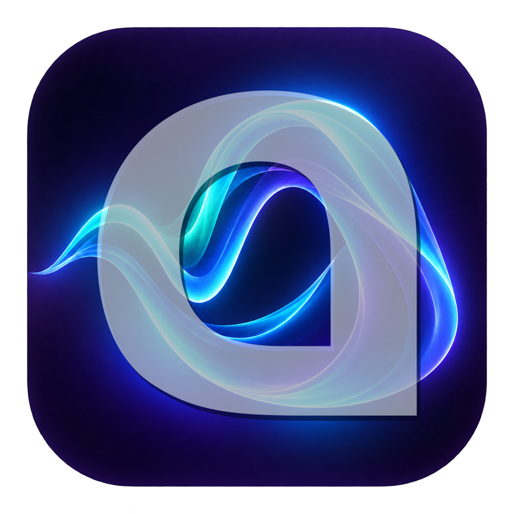
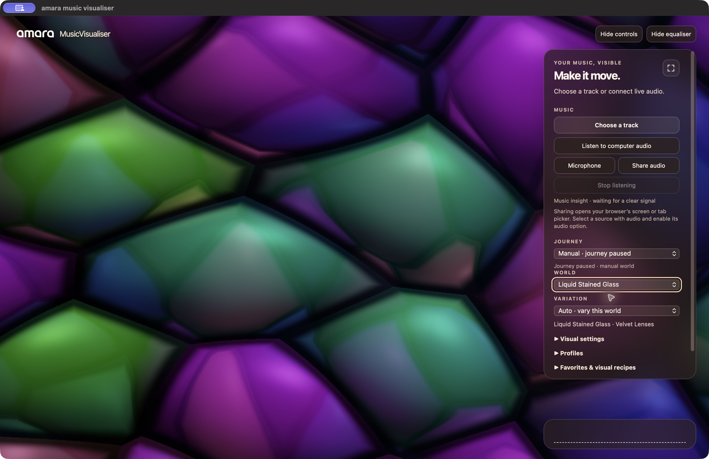

<div align="center">



# amara music visualiser

**Turn music into moving worlds.**

[Mac preview download](https://github.com/amara-gmbh/amara-music-visualiser/releases/tag/v0.1.0-mac-preview.2) · [Try the web version](https://musicvisualiser.amarawebdesign.de/) · [amara GmbH](https://amara.gmbh) · [Browser guide](web/README.md) · [Licence](LICENSE) · [Third-party notices](THIRD-PARTY-NOTICES.md)

</div>

amara music visualiser is eye candy for your music: a playful, psychedelic
experience inspired by the spirit of classic music visualisers. It brings
sound to life through GPU-rendered worlds: flowing
colour, abstract forms, landscapes, city lights and fractals. Choose a scene and
look, or let a journey move between them. Adjust colours and pace, save favourite
visual settings in your browser, and show or hide the controls and equaliser.



## Explore visual worlds

Move from flowing colour and abstract shapes to detailed fractals. Pick a world
and variation yourself, or let a journey choose for you.

## Listen your way

- **Music files:** choose a local audio file.
- **Microphone:** listen with the permission of your browser or system.
- **Shared audio:** use your browser’s tab or screen-sharing picker where supported.
- **Computer audio:** use the separately run local macOS or Windows audio bridge.

The public website supports local files, microphone and browser share-audio. A
web page alone does not provide the local desktop computer-audio bridge. Audio
is analysed on your device; the visualiser does not upload your music.

The web experience can run in a compatible desktop browser or as a
self-contained macOS web app. This repository also includes an earlier, separate
native Rust application; it does not have the same interface or feature set.

## Run locally

The browser edition needs Python 3 and a desktop browser with WebGPU support.
From the project root:

```sh
python3 -m http.server 8768 --bind 127.0.0.1
```

Open [localhost:8768/web/](http://127.0.0.1:8768/web/). This simple server
does not provide the computer-audio bridge. Press `Ctrl+C` to stop it.

### amara music visualiser for macOS

On an Apple silicon Mac with macOS 13 or newer, a WebGPU-capable system WebKit,
and Xcode Command Line Tools:

```sh
zsh scripts/build-web-macos.sh
open "outputs/web-macos/amara music visualiser.app"
```

The build script names the bundle `amara music visualiser.app`.
The Mac app keeps a stable local address for saved favourites and profiles.
Settings from older builds that used changing addresses are left untouched and
are not automatically imported; export them from the older build before upgrading.

The app bundles a local server and audio helper. macOS may request recording
permission; the legacy system-audio fallback uses screen-capture authorization.
Local builds are ad-hoc signed by default and are not notarized;
rebuilding may require permission to be granted again. An [unsigned Mac preview](https://github.com/amara-gmbh/amara-music-visualiser/releases/tag/v0.1.0-mac-preview.2)
is available. It is not Apple Developer ID signed or notarized; macOS Gatekeeper
may block it on first launch.

### Windows computer audio

With Node.js installed, launch `web/Start amaraMusicVisualiser.vbs` and choose
**Listen to computer audio**. The local bridge captures the default output.
See the [browser guide](web/README.md) for details and manual startup.

## Earlier native macOS application

A separate Rust application shares the world shaders with the browser edition.
Its interface and features differ from the browser experience. The native build
requires a third-party font that is not included in this repository; review its
[provenance and licence](assets/fonts/SOURCE.txt) before fetching or
redistributing it. The browser edition and macOS web app do not require this
font. The [browser guide](web/README.md) explains the other paths.

## Development

The native check script runs formatting, tests and Clippy with Cargo offline:

```sh
cargo fetch --locked
python3 scripts/fetch-optional-font.py
zsh scripts/check.sh
```

GPU and live-audio checks also require suitable hardware and permissions.
Browser and bridge test instructions are in the [browser guide](web/README.md).

## Licence

The original source code is offered under the [MIT licence](LICENSE).
Third-party components and assets retain their own terms; see
[third-party notices](THIRD-PARTY-NOTICES.md). The amara name and logo are
not granted under the MIT code licence.
